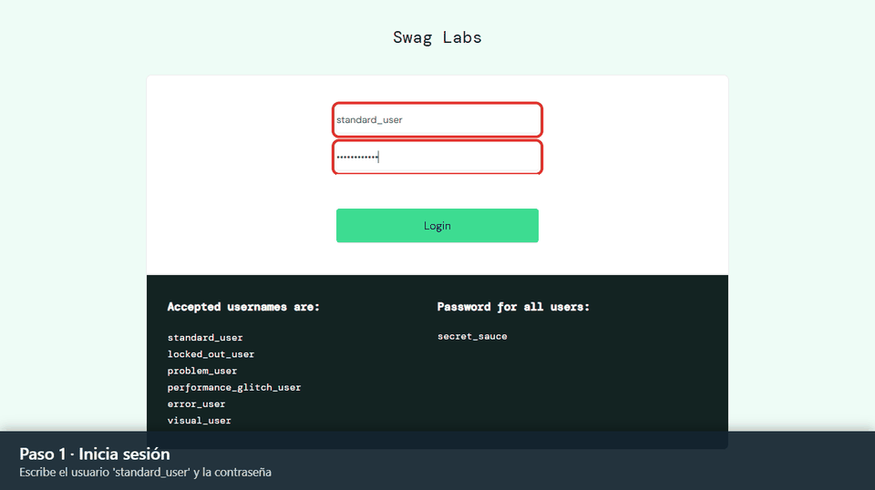
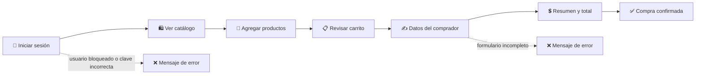
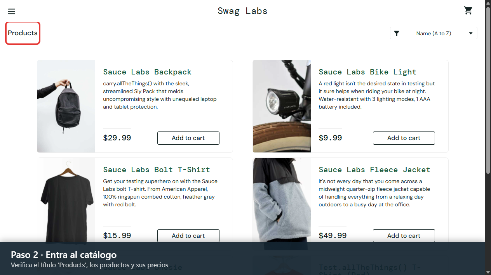
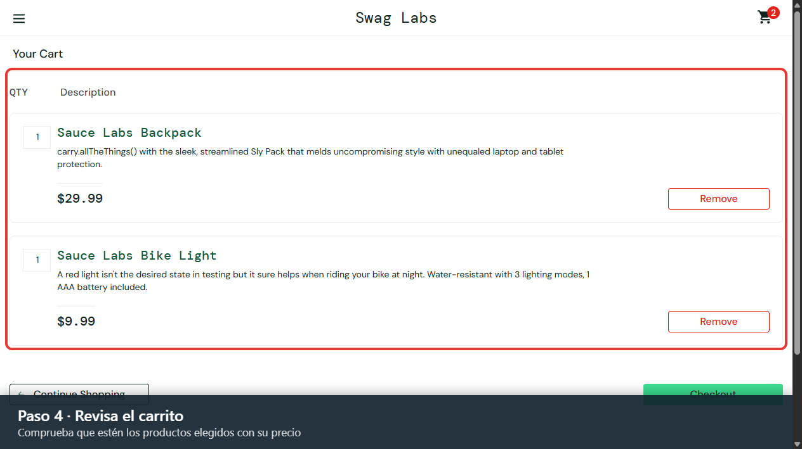
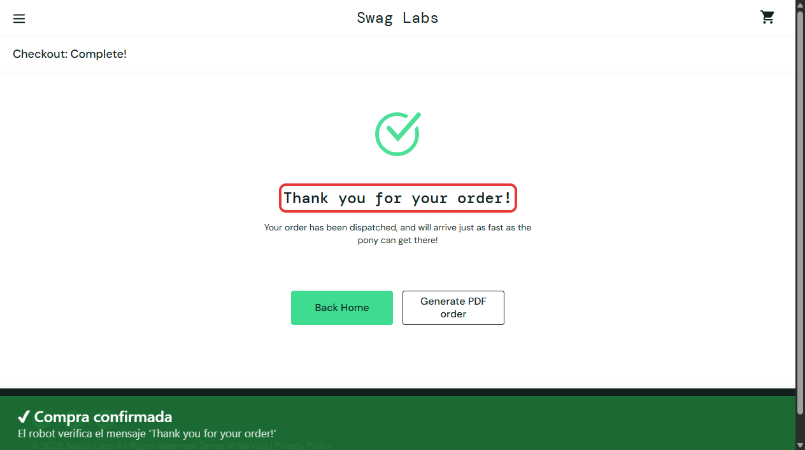
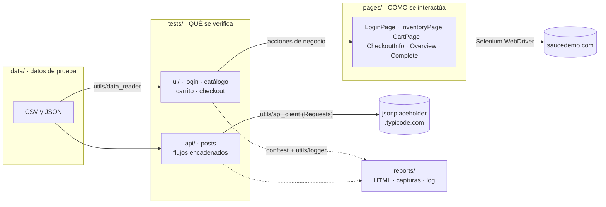

# Framework de Automatización de Pruebas — Tienda online + API

**Autor:** Roberto González · Proyecto final del curso de *Automation Testing* (QA)

---

## En pocas palabras

Este proyecto es un **robot que prueba un sitio web de forma automática**, como lo haría una persona del equipo de calidad (QA), pero en minutos y sin cansarse.

El robot abre el navegador, entra a una tienda online de práctica ([saucedemo.com](https://www.saucedemo.com/)), inicia sesión, recorre el catálogo, agrega productos al carrito, **completa una compra** y **verifica que todo funcione como debe**. Si algo falla:

- 📸 **saca una foto de la pantalla** en el momento del error,
- 📝 **deja un registro paso a paso** de lo que hizo,
- 📊 **arma un reporte visual** con lo que pasó y lo que falló.

Además prueba una **API**: la "puerta trasera" por la que las aplicaciones intercambian datos entre sí, sin pantalla de por medio. El robot le hace pedidos (consultar, crear y borrar información) y controla que las respuestas sean correctas. Es la misma tarea que hace un QA cuando valida que una app móvil y su servidor "se entiendan".

### 🎬 Mirá al robot en acción



*Grabación real del robot. El recuadro rojo marca el elemento con el que interactúa y el cartel de abajo explica qué está verificando. En verde, el resultado esperado; en rojo, los casos de error que el robot provoca a propósito.*

### ¿Por qué importa esto en una empresa?

| Sin automatización | Con este framework |
|---|---|
| Una persona repite las mismas pruebas a mano antes de cada versión | Las pruebas corren solas con un comando |
| Probar todo lleva horas | Lleva un par de minutos |
| Es fácil saltearse un caso | Siempre se ejecutan todos los casos |
| Cuando algo falla, hay que reproducirlo | Ya hay foto, registro y reporte del error |

### Qué demuestra este proyecto

- **Diseño de casos de prueba**: caminos felices (todo sale bien) y caminos negativos (contraseña incorrecta, usuario bloqueado, campos vacíos).
- **Código ordenado y fácil de mantener**: si la página cambia, se corrige en un solo lugar (patrón *Page Object Model*).
- **Pruebas guiadas por datos**: los usuarios y productos a probar están en planillas (CSV/JSON). Se agregan casos nuevos **sin programar**.
- **Evidencia y trazabilidad**: reportes, capturas de pantalla y registros detallados.
- **Trabajo profesional con Git**: cada funcionalidad se desarrolló en una rama propia y se integró después (ver historial de commits).

### El recorrido que hace el robot

Así recorre la tienda, igual que lo haría un cliente. Las flechas punteadas son los **casos negativos**: el robot se equivoca a propósito para comprobar que el sitio muestre el error correcto.



### Paso a paso

<table>
  <tr>
    <td width="50%"></td>
    <td width="50%"></td>
  </tr>
  <tr>
    <td></td>
    <td></td>
  </tr>
  <tr>
    <td></td>
    <td></td>
  </tr>
  <tr>
    <td colspan="2" align="center"></td>
  </tr>
</table>

**Casos negativos**: el robot se equivoca a propósito y verifica que el sitio lo detecte.

<table>
  <tr>
    <td width="50%"></td>
    <td width="50%"></td>
  </tr>
</table>

### Qué se prueba hoy

| Área | Qué verifica el robot | Casos |
|---|---|---|
| 🔐 Inicio de sesión | Que los usuarios válidos entren y los inválidos vean el mensaje de error correcto | 6 |
| 🛍️ Catálogo | Que se vean los productos, sus precios, el menú y el filtro | 4 |
| 🛒 Carrito | Que al agregar un producto aparezca en el carrito con el precio correcto | 4 |
| 💳 Compra (checkout) | La compra completa de punta a punta, que el total sume bien (productos + impuestos) y que el formulario incompleto muestre error | 5 |
| 🔌 API | Consultar, crear y borrar datos; que un pedido inválido devuelva el error correcto; flujos donde un pedido usa la respuesta del anterior | 9 |
| | **Total** | **28** |

> 🚧 **En desarrollo:** capturas dentro del reporte y ejecución automática en la nube (GitHub Actions).

### Un problema real que resolví

Al sumar el flujo de compra, algunas pruebas empezaron a fallar **al azar**: a veces pasaban y a veces no. Usando las fotos y el registro que genera el propio framework, encontré la causa. Después de iniciar sesión, Chrome mostraba un aviso de *"contraseña filtrada"* (la tienda de práctica usa una clave pública) que **bloqueaba los clics del robot**.

La solución fue configurar el navegador de pruebas para que no muestre ese aviso. Además, el robot ahora espera a que el carrito se actualice antes de avanzar. Resultado: **la suite pasa completa de forma estable**.

> Las pruebas inestables (*flaky tests*) son uno de los problemas más comunes en automatización. Este caso muestra por qué invertir en buenas evidencias (capturas y logs) ahorra tiempo de diagnóstico.

---

## Parte técnica

### Tecnologías utilizadas

| Herramienta | Para qué se usa |
|---|---|
| **Python 3.12** | Lenguaje principal |
| **Pytest** | Framework de testing (fixtures, parametrización, hooks) |
| **Selenium WebDriver 4** | Automatización del navegador Chrome |
| **Requests** | Pruebas de API REST |
| **pytest-html** | Reporte HTML de la ejecución |
| **webdriver-manager** | Descarga automática del ChromeDriver compatible |
| **logging** (módulo estándar) | Registro de pasos de la ejecución |
| **Git + GitHub** | Control de versiones (una rama por funcionalidad) |

### Estructura del proyecto

```
proyecto-final-automation-testing-roberto-gonzalez/
├── pages/                     # Page Objects: CÓMO se interactúa con cada página
│   ├── base_page.py           #   Clase base: esperas explícitas y acciones comunes
│   ├── login_page.py          #   Pantalla de login
│   ├── inventory_page.py      #   Catálogo de productos
│   ├── cart_page.py           #   Carrito
│   ├── checkout_info_page.py      # Checkout paso 1: datos del comprador
│   ├── checkout_overview_page.py  # Checkout paso 2: resumen y total
│   └── checkout_complete_page.py  # Checkout final: confirmación
├── tests/                     # Casos de prueba: QUÉ se verifica
│   ├── conftest.py            #   Driver de Chrome, capturas ante fallos, log de resultados
│   ├── ui/                    #   Pruebas de interfaz (Selenium)
│   │   ├── conftest.py        #     Fixture de sesión iniciada
│   │   ├── test_login.py      #     Login parametrizado desde CSV
│   │   ├── test_catalogo.py   #     Catálogo
│   │   ├── test_carrito.py    #     Carrito parametrizado desde JSON
│   │   └── test_checkout.py   #     Compra de punta a punta + formulario incompleto
│   └── api/                   #   Pruebas de API (Requests)
│       ├── conftest.py        #     Fixtures del cliente de API
│       ├── test_posts.py      #     GET, POST, DELETE y caso 404 sobre /posts
│       └── test_flujos_encadenados.py  # Peticiones que dependen de la anterior
├── data/                      # Datos de prueba externos
│   ├── usuarios_login.csv     #   Usuarios y resultado esperado del login
│   ├── productos.json         #   Productos a agregar y su precio esperado
│   ├── checkout.json          #   Comprador, productos a comprar y formularios incompletos
│   ├── esperados.json         #   Usuario válido y textos esperados
│   └── api.json               #   URL de la API, ids a consultar y post a crear
├── utils/                     # Herramientas de soporte
│   ├── logger.py              #   Logger del framework
│   ├── data_reader.py         #   Lectura de CSV y JSON
│   ├── driver_factory.py      #   Creación de Chrome con la configuración común
│   └── api_client.py          #   Cliente HTTP (Requests) con logging y validación de estructura
├── scripts/
│   └── generar_evidencia_visual.py  # Genera las capturas y el GIF del README
├── docs/img/                  # Imágenes del README (capturas paso a paso y GIF)
├── reports/                   # Salidas de la ejecución
│   ├── reporte.html           #   Reporte HTML
│   ├── screenshots/           #   Capturas automáticas de tests fallidos
│   └── logs/execution.log     #   Log detallado de la última ejecución
├── pytest.ini                 # Configuración de pytest y del logging
└── requirements.txt
```



**Separación de responsabilidades:** los tests nunca usan Selenium directamente. Le piden acciones a las páginas (`login_page.login(usuario, clave)`), y las páginas son las únicas que conocen los localizadores. Si cambia un elemento del sitio, se corrige en un solo archivo de `pages/`.

### Instalación de dependencias

Requisitos: **Python 3.10+** y **Google Chrome** instalado.

```bash
git clone https://github.com/rober-7/proyecto-final-automation-testing-roberto-gonzalez.git
cd proyecto-final-automation-testing-roberto-gonzalez

python -m venv venv
venv\Scripts\activate          # Windows
source venv/bin/activate       # Linux / Mac

pip install -r requirements.txt
```

No hace falta descargar ChromeDriver: `webdriver-manager` lo descarga automáticamente según la versión de Chrome instalada.

### Cómo ejecutar las pruebas

```bash
# Toda la suite, con reporte HTML
pytest --html=reports/reporte.html --self-contained-html

# Sin abrir la ventana del navegador (más rápido, ideal para CI)
pytest --headless --html=reports/reporte.html --self-contained-html

# Ver los pasos del log en vivo en la consola
pytest --headless --log-cli-level=INFO

# Solo UI o solo API (marcadores asignados automáticamente según la carpeta)
pytest -m ui --headless
pytest -m api

# Solo un archivo o un caso
pytest tests/ui/test_login.py
pytest tests/ui/test_carrito.py
pytest tests/ui/test_checkout.py
pytest -k "bloqueado"            # por nombre de caso
```

### Datos de prueba y parametrización

Los datos están separados del código, en `data/`. Cada fila o elemento se convierte en un caso de prueba independiente gracias a `@pytest.mark.parametrize`.

**`data/usuarios_login.csv`**: cada fila es un caso de login.

| caso | username | password | resultado_esperado | mensaje_error |
|---|---|---|---|---|
| usuario_estandar | standard_user | secret_sauce | exito | |
| usuario_bloqueado | locked_out_user | secret_sauce | error | Epic sadface: Sorry, this user has been locked out. |
| … | | | | |

La columna `caso` es el nombre con el que aparece el test en el reporte, por ejemplo `test_login_fallido_muestra_mensaje_de_error[usuario_bloqueado]`. **Para agregar un caso nuevo alcanza con sumar una fila al CSV.**

**`data/productos.json`**: lista de productos con su precio esperado. El test agrega cada uno al carrito y verifica que aparezca con ese precio.

**`data/checkout.json`**: datos del comprador, productos a comprar, tasa de impuesto esperada (8 %) y los formularios incompletos con el mensaje de error que debe mostrar cada uno.

**`data/api.json`**: URL base de la API, ids de posts a consultar (el test se repite por cada uno), id inexistente para el caso de error y el post a crear.

### Pruebas de API

Se prueban sobre [JSONPlaceholder](https://jsonplaceholder.typicode.com), una API REST pública de práctica. El cliente `utils/api_client.py` centraliza la URL base, el timeout y el registro en el log de cada petición y respuesta.

| Test | Método | Qué valida |
|---|---|---|
| `test_listar_posts_devuelve_todos_con_estructura_valida` | GET | 200, `Content-Type` JSON, 100 posts con campos y tipos correctos |
| `test_obtener_post_por_id[1, 50, 100]` | GET | 200, estructura y que el `id` devuelto sea el pedido |
| `test_obtener_post_inexistente_devuelve_404` | GET | **Escenario de error**: 404 y cuerpo vacío |
| `test_crear_post_devuelve_201_con_los_datos_enviados` | POST | 201, id asignado y que devuelva los mismos datos enviados |
| `test_eliminar_post_devuelve_200_y_cuerpo_vacio` | DELETE | 200 y cuerpo vacío |
| `test_obtener_usuario_y_luego_sus_posts` | GET → GET | **Encadenado**: el `id` del usuario se usa para pedir sus posts |
| `test_obtener_primer_post_del_usuario_y_luego_sus_comentarios` | GET → GET | **Encadenado**: el `id` del post se usa para pedir sus comentarios |

La estructura de cada respuesta se valida con `assert_estructura(objeto, esquema)`, que verifica que estén exactamente los campos esperados y con el tipo correcto. Por ejemplo, `{"id": int, "title": str}`.

En el log, cada petición queda registrada con su método, URL, código de respuesta, tiempo y cuerpo:

```
[INFO ] framework.api.client: --> POST https://jsonplaceholder.typicode.com/posts
[DEBUG] framework.api.client: Cuerpo enviado: {"title": "Automatizacion de pruebas con Python", ...}
[INFO ] framework.api.client: <-- 201 Created (931 ms)
```

> JSONPlaceholder simula las escrituras: el POST y el DELETE responden como si funcionaran, pero no guardan cambios. Por eso los flujos encadenados usan recursos relacionados (usuario → posts → comentarios) en lugar de "crear y luego consultar".

### Cómo interpretar los resultados

#### Reporte HTML: `reports/reporte.html`

Se abre con cualquier navegador. Contiene:
- **Resumen**: cantidad de tests pasados (*Passed*), fallados (*Failed*) y con error (*Errors*), y la duración total.
- **Tabla de resultados**: un renglón por test con su estado y duración. Los tests parametrizados muestran el caso entre corchetes.
- **Detalle de cada test**: al expandir un renglón se ve el log de pasos (*Captured log*) y, si falló, el error exacto.

#### Capturas de pantalla: `reports/screenshots/`

Cuando un test de UI falla, se guarda automáticamente una captura con el nombre del test y la fecha/hora, por ejemplo `test_login_exitoso_redirige_al_inventario_20261118_221733.png`.

#### Log de ejecución: `reports/logs/execution.log`

Registro detallado de la última ejecución. Cada test aparece delimitado por `INICIO` y `RESULTADO`:

```
2026-11-18 22:16:32 [INFO   ] framework.conftest: ========== INICIO: tests/ui/test_login.py::... ==========
2026-11-18 22:16:32 [INFO   ] framework.conftest: Iniciando Chrome (headless=True)
2026-11-18 22:16:35 [INFO   ] framework.pages.LoginPage: Iniciando sesion con usuario 'standard_user'
2026-11-18 22:16:35 [DEBUG  ] framework.pages.LoginPage: Escribiendo '*****' en: id=password
2026-11-18 22:16:36 [INFO   ] framework.conftest: RESULTADO: tests/ui/test_login.py::... -> PASSED (1.06s)
```

| Nivel | Significado |
|---|---|
| `INFO` | Paso de negocio (login, agregar al carrito, resultado del test) |
| `DEBUG` | Acción técnica sobre un elemento (click, escribir, esperar) |
| `WARNING` | Se guardó una captura de pantalla |
| `ERROR` | Un test falló; incluye el detalle del error |

Las contraseñas se enmascaran (`*****`) en el log.

### Imágenes del README

Las capturas y el GIF de este README **no están editadas a mano**: las genera un script que recorre la tienda con los mismos Page Objects que usan los tests. En cada paso inyecta en la página el recuadro rojo y el cartel explicativo antes de sacar la captura. Para regenerarlas, por ejemplo si cambia el sitio:

```bash
python scripts/generar_evidencia_visual.py
```

Las imágenes se guardan en `docs/img/`. El GIF se arma con Pillow, incluida en `requirements.txt`.

### Independencia de los tests

Cada test abre su propio navegador y, si lo necesita, inicia su propia sesión con el fixture `inventory_page`. Por eso la falla de un test no afecta a los demás, y los tests pueden ejecutarse en cualquier orden o de forma individual.
